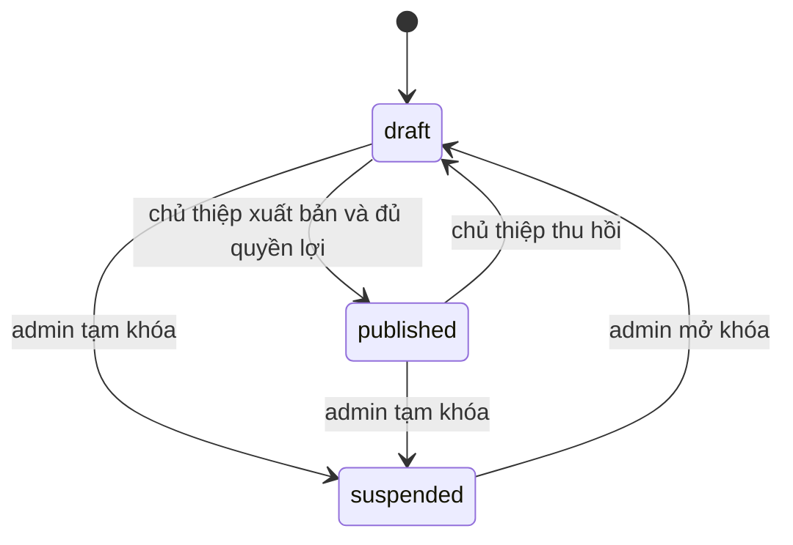
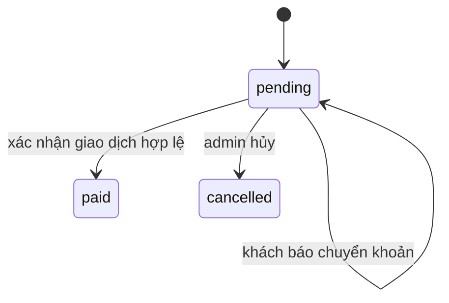
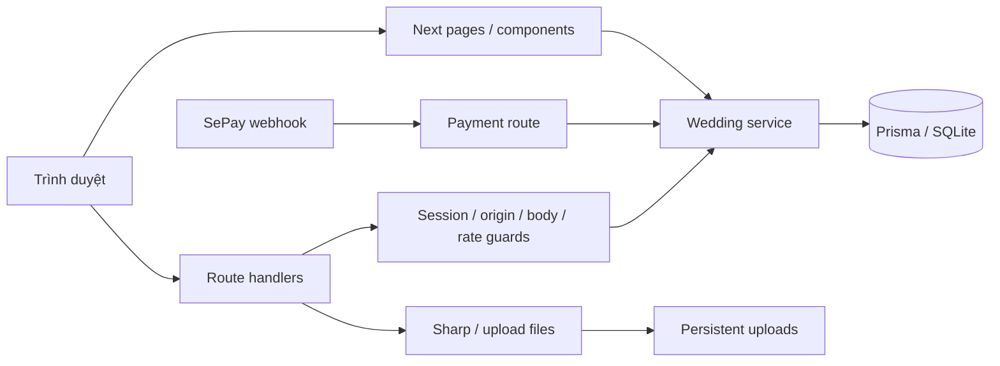

# Wedding Platform — Product & Design Specification

Ngày đối chiếu: 03/10/2026. Baseline mã: `53bea9c` trên `main`.

## 1. Trạng thái và nguồn yêu cầu

Đây là đặc tả được bổ sung **sau triển khai**, theo cấu trúc design/spec của Superpowers. Nội dung đối chiếu mã hiện tại, yêu cầu của chủ dự án và nghiên cứu trong [RESEARCH](../../RESEARCH.md). Không khẳng định dự án đã thực hiện brainstorming, phê duyệt thiết kế hoặc TDD trước khi xây. Người dùng đã yêu cầu bổ sung và commit/push tài liệu; chưa chốt thương hiệu, giá bán, chính sách hoặc thông tin đám cưới thật.

Mục tiêu: làm thiệp cưới cho anh trai chủ dự án, đồng thời bán dịch vụ thiệp online cho các cặp đôi khác. Dự án clone `my_task`, giữ nền xác thực/bảo vệ HTTP, thay miền bán hàng/POS bằng miền cưới. Hai mẫu tham khảo chỉ cung cấp ý tưởng trải nghiệm; không sao chép mã, ảnh hay thông tin riêng của cặp đôi.

## 2. Vai trò và kết quả cần đạt

| Vai trò             | Kết quả                                                           | Phạm vi quyền                                               |
| ------------------- | ----------------------------------------------------------------- | ----------------------------------------------------------- |
| Người xem website   | Chọn mẫu, xem preview, xem giá                                    | Catalog công khai; preview không gửi RSVP                   |
| Khách mua dịch vụ   | Tạo, sửa, thanh toán và xuất bản thiệp                            | Thiệp, đơn, khách mời và phản hồi thuộc tài khoản mình      |
| Khách dự cưới       | Đọc thông tin, chọn tiệc, RSVP và gửi lời chúc                    | Thiệp công khai hợp lệ; token riêng chỉ xác định lời mời đó |
| Admin owner/manager | Quản lý catalog, xác nhận tiền, khóa thiệp/tài khoản, xem nhật ký | Cần phiên admin hợp lệ tại server                           |

Chỉ role `owner` được đổi cấu hình nhận tiền/hỗ trợ (`admin/settings`); manager xem trang cấu hình ở chế độ chỉ đọc và vẫn xác nhận/hủy đơn. Role `staff` tồn tại trong schema kế thừa nhưng không được quyền thực hiện mutation quản trị wedding. Không có hệ thống phân quyền tùy chỉnh hoặc giao diện tạo nhiều quản trị viên trong bản đầu.

## 3. Phạm vi và ràng buộc toàn dự án

- Node 22; pnpm 10.28.2; Next.js 16.3.8; React 19.2.4; Prisma 6.19.3; Zod 4.
- Văn bản hướng tới khách hàng bằng tiếng Việt; hiển thị giờ theo `Asia/Ho_Chi_Minh`.
- Tiền dùng integer VND. Giá/quyền lợi của đơn được snapshot từ server.
- Production một Node instance, SQLite và uploads trên volume bền vững.
- Không commit `.env`, `.local-admin-password`, DB hoặc ảnh khách tải lên.
- Phiên khách và admin tách riêng; quyền sở hữu được kiểm tra tại server.
- Thiệp công khai cần `published`, chủ tài khoản đang hoạt động và gói `paid` chưa hết hạn.
- Tiền mua dịch vụ và tiền mừng cưới là hai luồng độc lập.
- Commit từng phần đã kiểm tra, push vào `origin` của `happy_wedding`; không push vào `base`.

Không thuộc bản đầu: kéo-thả tự do, video, tên miền riêng từng thiệp, OTP, khôi phục mật khẩu tự phục vụ, gửi SMS/email/Zalo, tự động hoàn tiền, nhập Excel, analytics, AI viết nội dung, bán thiệp in và nhiều instance.

## 4. Ba phân hệ

### A. Catalog, tài khoản và biên tập thiệp

Trang chủ giới thiệu dịch vụ. `/templates` hỗ trợ tìm kiếm và lọc; `/templates/[slug]` mô tả mẫu; `/preview/[slug]` xem thiệp minh họa. Năm layout `editorial`, `botanical`, `classic`, `minimal`, `cinematic` kết hợp sáu palette `rose`, `sage`, `wine`, `sand`, `midnight`, `terracotta`; seed tạo mười mẫu. Minimal là thư mời chữ trước/ảnh ngang, cinematic là ảnh phủ khung và bảng chữ nền đặc. Editor có link mở preview minh họa của mẫu đang chọn; preview nội dung khách vẫn dùng bản đã lưu. Admin quản lý cấu hình mẫu, chưa có trình thiết kế HTML/CSS tùy ý.

Khách đăng ký bằng số điện thoại và mật khẩu tối thiểu 10 ký tự. Số được chuẩn hóa; chưa xác minh quyền sở hữu số qua OTP. Thông báo đăng ký tránh tiết lộ tài khoản tồn tại. Đăng nhập xong khách dùng dashboard; liên kết chọn mẫu được giữ qua chuyển hướng đăng nhập an toàn.

Thiệp có tên hai người, ngày cưới, tiêu đề, câu chuyện, gia đình, 1–4 tiệc, ảnh bìa, album, nhạc HTTPS tùy chọn và hai tài khoản ngân hàng mừng cưới nhà trai/nhà gái tùy chọn. Mỗi bên điền đủ ngân hàng, tài khoản, chủ tài khoản hoặc bỏ trống; mã QR có nút sao chép tài khoản và mở ảnh để lưu, thông tin chuyển khoản vẫn đọc được khi QR lỗi. Slug duy nhất, chữ thường/số/gạch ngang, dài 3–80. Slug của thiệp đã xuất bản chỉ đổi sau khi thu hồi.

Mỗi tiệc có `title`, `date`, `venue`, `address` và `timeLabel` tùy chọn (từ 31/10/2026). Lịch, Maps và lựa chọn RSVP dùng cùng mảng tiệc. Input datetime local được đổi sang ISO với offset Việt Nam; lưu DateTime trong DB. Mảng tiệc/ảnh lưu JSON có Zod kiểm tra lúc đọc và ghi. `timeLabel` là giờ ghi bằng chữ, ví dụ “Buổi sáng”, cho tiệc không có giờ cụ thể: Zod trim, tối đa 40 ký tự, chuỗi rỗng coi như không có và không được lưu. Khi có nhãn, mọi chỗ thiệp hiện giờ của tiệc (ở cả mười mẫu) hiện nhãn thay giờ, ngày vẫn hiện. `date` vẫn bắt buộc: nó cho ngày hiển thị, ngày trên lịch và việc so khớp đúng với `weddingDate`; thứ tự tiệc là thứ tự nhập trong editor. Link thêm vào lịch của tiệc có nhãn là sự kiện cả ngày ([ADR 0007](../../adr/0007-event-written-time-label.md)). Tiệc không có nhãn hiển thị và lưu y như trước. Từ 01/11/2026 mỗi tiệc có thêm link Google Maps tùy chọn (`mapUrl`, chỉ https và host Google Maps) và cặp tọa độ `lat`/`lng` trong khung Việt Nam; editor đọc tọa độ từ link dài, còn link rút gọn không được server gọi tới ([ADR 0009](../../adr/0009-event-map-without-link-resolution.md)). Mỗi địa điểm khác nhau có một thẻ tiệc, trong thẻ là đúng một bản đồ Google nhúng của nơi đó (xem “Gộp thẻ tiệc theo địa điểm — 01/11/2026”); iframe tải lười, không gửi referrer để token khách mời không lọt ra ngoài, có góc bo riêng cho từng mẫu. Nút “Chỉ đường đến tiệc” mở `mapUrl` khi có.

Bản nháp tối đa 12 ảnh; gói trả phí có giới hạn snapshot 1–40. Upload yêu cầu phiên và thiệp đã lưu thuộc chủ tài khoản; nhận JPG/PNG/WebP tối đa 40 MB/ảnh (5 MB trước 01/11/2026), decode tối đa 64 megapixel, cạnh dài tối đa 16.383 px; định dạng được kiểm tra theo nội dung tệp chứ không chỉ theo Content-Type. Ảnh có khung giải mã ước lượng trên 200 MiB bị từ chối trước khi decode, với lỗi “Ảnh quá lớn để xử lý, vui lòng dùng ảnh JPEG 8-bit”. Trong ước lượng này, ảnh có alpha tính 8 byte/điểm ảnh. Ảnh JPEG 8-bit tới 64 megapixel vẫn được nhận, còn PNG 16-bit có alpha lớn thì không. Mỗi tiến trình chỉ mã hóa 2 ảnh cùng lúc; ảnh khác xếp hàng (tối đa 10 ảnh, chờ tối đa 60 giây), chỉ khi hàng đầy hoặc chờ quá lâu mới báo “Máy chủ đang bận, vui lòng thử lại sau”. Ảnh giữ nguyên độ phân giải gốc sau khi xoay theo EXIF, không thu nhỏ; vẫn được mã hóa lại sang WebP chất lượng 90 để bỏ toàn bộ metadata (EXIF, GPS, XMP) và đưa màu về sRGB ([ADR 0008](../../adr/0008-full-resolution-uploads.md)). Ảnh phục vụ qua URL công khai; trang thiệp hiển thị qua `next/image` (bản rộng tối đa 2048 px), nên trình duyệt thường nhận bản thu nhỏ theo `sizes`; khi bộ tối ưu lỗi hoặc quá 7 giây, Next trả file gốc ([ADR 0008, phần hiển thị](../../adr/0008-full-resolution-uploads.md#hien-thi-va-file-goc)). Nhạc chỉ phát khi người xem chủ động bật.

Mỗi lần sửa tăng `version`. Lưu với version cũ trả 409 để tránh ghi đè. Thiệp bị admin suspend không được sửa hoặc tự xuất bản. Khi đã có RSVP, không thay số lượng tiệc; thứ tự tiệc phải được giữ để `eventIndex` tiếp tục trỏ đúng. Hiện không có ID ổn định riêng cho từng tiệc.

### B. Đơn dịch vụ, thanh toán và quản trị

`/pricing` đọc gói active. Bảng so sánh và trang mua gói dùng cùng catalog: giá, thời hạn, số ảnh, mẫu cao cấp, thương hiệu. Phần tiện ích chung giải thích QR hai bên, lịch tiệc, RSVP, lời mời riêng và CSV. FAQ nói rõ bản nháp 12 ảnh, thời hạn từ lúc xác nhận và gia hạn không cộng dồn quyền lợi hay trừ tiền gói cũ. Thẻ mẫu có liên kết trực tiếp tới thiệp preview đầy đủ; chi tiết không gắn quyền mẫu cao cấp vào tên gói cố định. Seed tạo 199.000/399.000/699.000 VND, thời hạn 12/18/36 tháng, số ảnh 12/24/40. Đây là dữ liệu khởi tạo, chưa phải bảng giá chủ dịch vụ xác nhận.

Mua gói gắn với một thiệp của tài khoản. Server đọc plan active và snapshot `planName`, `total`, `months`, `maxPhotos`, `premiumTemplates`, `removeBranding`. `clientId` UUID hỗ trợ retry; cùng ID nhưng khác tài khoản/thiệp/gói trả 409. Một đơn pending cùng tài khoản/thiệp/gói được tái sử dụng. Mã chuyển khoản dạng `HY` + 12 hex.

Ngân hàng nhận tiền dịch vụ cấu hình tại `/admin/settings`; để trống thì không tạo QR ngân hàng giả. Bấm báo đã chuyển chỉ cập nhật `paymentNote`; đơn vẫn pending.

Admin xác nhận bằng mã giao dịch sao kê và số tiền đúng tuyệt đối. `confirmPayment` là đường duy nhất kích hoạt: transaction kiểm tra giao dịch duy nhất, ghi `WeddingPayment`, chuyển order thành paid, tính expiry và ghi audit. Sai số tiền hoặc đơn cancelled không kích hoạt. Retry cùng giao dịch không cộng thời hạn hai lần; giao dịch đã dùng cho đơn khác trả 409. Với đơn đã paid, lần xác nhận mới trả đơn hiện tại và không ghi thêm khoản tiền; chưa có đối soát khoản trả thừa/hoàn tiền.

Gia hạn cộng tháng UTC sau expiry còn hiệu lực dài nhất, hoặc sau thời điểm thanh toán nếu không còn gói. Quyền hiện tại chọn một order paid còn hạn theo `maxPhotos` giảm dần, sau đó `expiresAt` giảm dần; **không hợp nhất quyền của nhiều order**. Khi thay quy tắc nâng/hạ gói phải có đặc tả riêng.

Cấu hình thanh toán dịch vụ có chọn ngân hàng, QR xem trước và liên hệ điện thoại/email trực tiếp trên đơn; khi QR không tải được vẫn hiện thông tin chuyển khoản và nút thử lại. Không dùng tài khoản mừng cưới cho thanh toán dịch vụ.

SePay là tùy chọn. Tài khoản nhận tiền đã lưu phải khớp cấu hình máy chủ; thay đổi làm webhook tạm ngừng (503) cho tới khi đồng bộ. Endpoint xác minh API key thời gian hằng, đúng tài khoản, tiền vào, mã đơn và số tiền. Giao dịch không thuộc đơn hợp lệ được acknowledge và bỏ qua; thiếu cấu hình trả 503; API key sai trả 401; sai số tiền trả 400. Dùng `sepay:<id>` cho idempotency. Chưa kiểm chứng tài khoản sandbox/live của chủ dự án.

Admin có dashboard, đơn/bộ lọc, catalog, khách hàng, thiệp, settings và audit. Khóa tài khoản thu hồi phiên và ẩn các thiệp; mở lại tài khoản không tự phục hồi phiên. Suspend thiệp tăng version; restore về draft. Đổi giá hoặc ngừng bán gói không đổi snapshot cũ. Ngừng cung cấp mẫu không ẩn thiệp đang dùng; không được đổi premium của mẫu có thiệp published.

### C. Thiệp công khai, khách mời và RSVP

`/w/[slug]` tra cứu điều kiện công khai ở server. Hết hạn được ẩn ngay lúc đọc; không cần cron đổi `status`. Có tên cặp đôi, gia đình, câu chuyện, đếm ngược, tiệc/bản đồ/thêm lịch, album, nhạc, lời chúc đã duyệt và QR mừng cưới.

Thiệp và preview mở đầu bằng hai cánh cửa theo palette, tên cặp đôi, ngày cưới và tên khách (nếu có). Nút “Mở thiệp” chạy hiệu ứng; “Xem ngay, bỏ qua hiệu ứng” hoặc Escape mở tức thì, trả focus vào tiêu đề và mới bắt đầu hiệu ứng nội dung; reduced motion mở ngay, không JavaScript vẫn đọc thiệp trực tiếp. Lời yêu thay hai cánh cửa bằng một phong bì giấy ngà có dấu sáp: chạm phong bì hoặc bấm “Mở thiệp” thì dấu sáp vỡ, nắp lật, lá thư trượt lên, tim bay, rồi phong bì mờ đi để lộ ảnh vòm. Nút, bỏ qua hiệu ứng, Escape và reduced motion giữ nguyên hành vi.

Thiệp và preview giữ nguyên phối màu; phần mở đầu/nội dung hiện lần lượt khi vào viewport, ảnh bìa zoom chậm, trang trí nhẹ theo layout. Chuyển động theo cuộn chạy bằng CSS scroll timeline, không có JavaScript theo từng frame cuộn ([ADR 0006](../../adr/0006-css-scroll-driven-motion.md)): thanh tiến trình đầu trang theo `scroll(root)`; ở Lời yêu, chương ảnh ghim giữa màn hình, khung chân dung mở ra toàn cảnh, bốn ảnh in tản ra trước khi che khuôn mặt rồi cảnh thứ hai quét ngang, cuộn ngược đảo lại. JavaScript chỉ phát hiệu ứng vào cảnh một lần qua IntersectionObserver và tạm dừng hoa rơi khi hero ra khỏi màn hình; điện thoại chỉ giữ nửa số cánh hoa. Trình duyệt chưa hỗ trợ scroll timeline nhận ảnh tĩnh như reduced motion. Album mở bằng dialog, hỗ trợ nút trước/sau, phím mũi tên, Escape và trả focus về ảnh đã chọn. Hiệu ứng là progressive enhancement: nội dung server vẫn đọc được khi chưa có JavaScript; chế độ giảm chuyển động tắt CSS animation và animation qua Web Animations API. Nhạc chỉ phát khi khách chủ động bật.

Lời yêu là một lá thư tình. Tên cặp đôi viết tay (Ephesis), tiêu đề và chữ số dùng Cormorant Garamond, màu nhấn champagne. Hero là ảnh vòm có khung lệch phía sau. Countdown là dải sẫm tràn ngang với lịch ngà nghiêng, vòng mực khoanh ngày cưới, và lời cảm ơn kết bằng chữ ký tên cặp đôi. Khi mở thiệp có hiệu ứng, ảnh vòm lộ từ dưới lên và hai tên được ký lần lượt. Vòng khoanh, hairline tiêu đề và chữ ký chạy một lần khi phần đó hiện ra. Font tự host qua `next/font/local`, subset Latin + tiếng Việt, không preload; mẫu khác không tải. Reduced motion, bỏ qua hiệu ứng hoặc không JavaScript thấy ngay trạng thái hoàn chỉnh. Bốn chi tiết đi theo cuộn, không lặp vô hạn ([ADR 0006](../../adr/0006-css-scroll-driven-motion.md)): con dấu chữ vòng ghi tên và ngày trên ảnh vòm, xoay khi hero cuộn đi; hai dải ruy băng chéo dưới hero trượt ngược chiều; chữ “Thương” viết dần ngang ảnh câu chuyện; sợi tơ hồng nối các thẻ tiệc. Cả bốn chỉ để trang trí (`aria-hidden`) và đứng yên ở trạng thái hoàn chỉnh khi bật reduced motion. Trên điện thoại, tên nằm trên chân ảnh, và ảnh cao theo khối tên khi tên dài ([ADR 0004](../../adr/0004-template-configuration-and-edit-concurrency.md)).

Thiệp dùng nhãn tiếng Việt, lối tắt lịch tiệc/RSVP/album/mừng cưới, nội dung và form 16px, giờ tiệc 18px. Bỏ opacity làm mờ đoạn văn; sắc đất dùng chữ đậm hơn để đạt tương phản trên nền tint. Responsive giữ điều hướng chính hiển thị trên mobile, tăng vùng bấm và cỡ chữ form lên 16px ở ≤800px. Bố cục, ảnh bìa, countdown, tên dài, QR và album thích nghi từ 320px tới desktop; màn mở thiệp thu gọn khi xoay ngang. Dashboard dùng header xuống dòng, bảng rộng cuộn trong vùng bảng, không che nội dung bằng header cố định trên điện thoại.

Chủ thiệp tạo tối đa 2.000 lời mời cá nhân, mỗi lời mời có tên, nhóm và token ngẫu nhiên 24 byte. URL cá nhân có query `guest`; token là capability dùng để tra lời mời, không phải tài khoản và không cấp quyền dashboard. Không log token; referrer policy `no-referrer`. Mẫu preview và thiệp demo được phân biệt rõ với thiệp thật.

RSVP gồm UUID client, tên, attendance (`attending`, `declined`, `undecided`), số người 1–10, tiệc theo index và lời nhắn tối đa 1.000 ký tự. Từ 01/11/2026 form chỉ gửi `attending` hoặc `declined`; API vẫn nhận `undecided` để phản hồi cũ, hợp đồng API và trang đã mở từ trước tiếp tục chạy. Index phải trỏ đến tiệc tồn tại. Không attending thì lưu partySize bằng 0. Có token riêng thì dùng guest ID làm khóa ổn định qua thiết bị; không có token thì dùng client UUID, không bảo đảm dedupe khi đổi trình duyệt/xóa dữ liệu local.

Từ 01/11/2026, form RSVP là một cột radio thật (`fieldset` + `legend`), không còn danh sách tên tiệc: khách chọn có tham dự không (chỉ hai lựa chọn “Có, mình sẽ tham dự” và “Mình rất tiếc, không thể đến”), rồi chọn bên (Nhà trai/Nhà gái, chỉ hỏi khi thiệp có tiệc của cả hai nhà) và số người. Theo yêu cầu của chủ một thiệp đang chạy, form bỏ câu “Bạn đến vào ngày nào?” cùng các chip ngày và bỏ lựa chọn “Mình sẽ xác nhận sau”; đây là quyết định của chủ sản phẩm, áp dụng cho mọi thiệp, không có cài đặt riêng từng thiệp. Bên lấy từ trường tùy chọn `side` của tiệc, thiếu thì đoán theo tên (“nhà trai”; “nhà gái” hoặc “vu quy”); tiệc chung thuộc cả hai bên. Payload giữ nguyên dạng: `eventIndex` là chỉ số gốc của tiệc đầu tiên thuộc bên đã chọn (tiệc chung tính cho cả hai bên; thiệp không hỏi bên thì là tiệc đầu tiên), 0 khi không tham dự; số người chọn bằng nút −/+ từ 1 đến 10. Vì khách không chọn ngày, danh sách phản hồi ở dashboard và cột “Tiệc” của CSV ghi bên (“Nhà trai”/“Nhà gái”) khi tiệc khách đến có bên; tiệc chung giữ cách hiện cũ (tên tiệc kèm ngày giờ ở dashboard, số thứ tự tiệc trong CSV), phản hồi không tham dự cũng giữ như cũ. Phản hồi `undecided` cũ vẫn hiện “Chưa rõ”/“Chưa quyết định” và vẫn có bộ đếm riêng.

Unique `(invitationId, clientId)` khiến retry cập nhật một phản hồi. Mọi lần gửi/cập nhật đặt lời chúc về pending. Chủ thiệp duyệt approved hoặc hidden; công khai chỉ thấy approved. Chỉ pending là chưa duyệt: hidden vẫn tính là đã duyệt, chỉ không hiện trên thiệp (xem “Lời chúc đã ẩn vẫn là đã duyệt — 01/11/2026”). Chủ thiệp xem danh sách có phân trang và xuất tối đa 10.000 phản hồi CSV; escape dấu nháy và vô hiệu prefix công thức. CSV xuất phản hồi, không phải toàn bộ khách chưa RSVP.

## 5. Trạng thái và điều kiện truy cập

Hết hạn gói/khóa chủ tài khoản là điều kiện ẩn khi đọc; không phải trạng thái thiệp mới.

Không có transition paid → cancelled/refunded qua API hiện tại. Lời chúc độc lập với attendance: pending → approved/hidden; approved ↔ hidden; gửi lại → pending. Chủ thiệp không đưa được lời chúc về pending.

## 6. Kiến trúc và dữ liệu

Pages đọc dữ liệu tại server; browser gọi API cho mutation. Một số thao tác admin/catalog nằm trực tiếp trong route handler, chưa tất cả được gom vào service. Session và middleware bảo vệ URL không thay thế kiểm tra quyền ở route/domain. Mỗi page dưới `/admin` tự gọi `requireAdminPage()` trước khi đọc dữ liệu; layout không chạy lại khi điều hướng client và request RSC có thể render riêng segment page, nên guard ở layout không đủ (ADR 0005).

| Entity                            | Trách nhiệm và liên kết                                         |
| --------------------------------- | --------------------------------------------------------------- |
| CustomerAccount / CustomerSession | Chủ thiệp, số điện thoại duy nhất, phiên có thể thu hồi         |
| AdminIdentity / AdminSession      | Danh tính, role, version và phiên quản trị                      |
| WeddingTemplate                   | Layout/palette, active, premium; liên kết nhiều thiệp           |
| ServicePlan                       | Catalog giá/quyền lợi hiện tại                                  |
| Invitation                        | Thuộc một customer/mẫu; slug unique; version; nội dung/tiệc/ảnh |
| ServiceOrder                      | Thuộc customer/thiệp/plan; snapshot và thời hạn                 |
| WeddingPayment                    | Thuộc order; transaction ID globally unique có prefix provider  |
| WeddingGuest                      | Thuộc thiệp; token unique; tên và nhóm                          |
| GuestResponse                     | Thuộc thiệp, guest tùy chọn; RSVP và moderation                 |
| AdminAuditEvent / Setting         | Lưu quyết định quản trị và cấu hình merchant                    |

Schema dùng String cho trạng thái, không có enum/check constraint DB cho các giá trị nghiệp vụ. Validation hiện thuộc Zod/domain. Audit payment và khóa khách nằm cùng transaction; một số audit admin khác ghi sau mutation, chưa bảo đảm nguyên tử cho tất cả thao tác.

## 7. Hợp đồng và an toàn

Hợp đồng request, response và quyền tại [API-CONTRACTS](../../API-CONTRACTS.md). HTTP guards chặn origin không tin cậy, JSON body quá lớn, thiếu phiên, truy cập chéo chủ thiệp và rate-limit. Không tin price/status/ownerId từ browser. Production yêu cầu Redis/HMAC/origin/proxy hợp lệ, fail closed; build placeholder không dùng làm runtime cấu hình.

Không đưa hash/token/API key/nội dung riêng vào log. UI thông báo lỗi miền bằng tiếng Việt; lỗi ngoài dự kiến chỉ trả thông báo chung/correlationId. Secret chỉ nằm môi trường, không trong admin settings hoặc Git.

SQLite là giới hạn triển khai: không writer phân tán, transaction ngắn, chỉ gọi `tx` bên trong interactive transaction. Backup SQLite online + ảnh; cần tạm dừng ghi nếu muốn snapshot DB/ảnh đồng nhất. Upload được ghi vào `WeddingUpload` với quota 120 ảnh/thiệp và 150 ảnh/account/24 giờ. Chưa có retention tự động, xóa tài khoản tự phục vụ hoặc cleanup ảnh mồ côi.

## 8. Nghiệm thu và bằng chứng

| ID  | Tiêu chí                                                     | Mã/bằng chứng                                               |
| --- | ------------------------------------------------------------ | ----------------------------------------------------------- |
| A1  | Chọn mẫu, giữ lựa chọn qua đăng nhập, tạo/sửa preview        | `src/app/dashboard/new/page.tsx`, `e2e/wedding.spec.ts`     |
| A2  | Lưu bảo vệ owner/version/slug; giới hạn ảnh                  | `saveInvitation`, `tests/server/wedding/service.test.ts`    |
| A3  | Upload ảnh thật trong editor; mobile không cuộn ngang        | upload route, browser journey                               |
| B1  | Snapshot giá và retry order không nhân đôi                   | `createServiceOrder`, domain tests                          |
| B2  | Báo chuyển khoản không tạo quyền; xác nhận admin mới có paid | API payment-note, browser journey                           |
| B3  | Exact amount, unique transaction, retry, gia hạn             | `confirmPayment`, domain tests                              |
| B4  | Webhook key/tài khoản/hướng tiền/mã đơn đúng                 | SePay route, webhook tests; chưa phải bank integration live |
| B5  | Khóa chủ/thiệp có tác dụng và không bị owner vượt qua        | guards/service/admin route, domain tests                    |
| C1  | Unpaid/draft/expired không công khai hoặc nhận RSVP          | `publicInvitation`, domain tests                            |
| C2  | Personal RSVP ổn định, moderation pending, index hợp lệ      | `submitResponse`, domain/browser tests                      |
| C3  | Duyệt lời chúc rồi công khai; CSV chỉ của owner              | browser journey và export route review                      |

Kết quả test/build đã ghi ở [VERIFICATION](../../VERIFICATION.md), thuộc lần kiểm tra ứng dụng trước lượt bổ sung docs. Lượt tài liệu này chỉ xác minh đường dẫn, nội dung đối chiếu, formatting và Git; không tuyên bố đã chạy lại toàn bộ ứng dụng.

## 9. Việc còn cần trước mở bán

| Việc                         | Người cung cấp/quyết định     | Điều kiện hoàn thành                                                              |
| ---------------------------- | ----------------------------- | --------------------------------------------------------------------------------- |
| Nội dung cưới thật           | Chủ dự án/cặp đôi             | Tên, gia đình, lịch/địa chỉ và ảnh được phép dùng; gia đình duyệt trên điện thoại |
| Thương hiệu, giá, chính sách | Chủ dịch vụ                   | Chốt tên/giá/hạn lưu/hoàn tiền, thay trang chính sách dự thảo                     |
| Ngân hàng dịch vụ/mừng cưới  | Hai chủ tài khoản tương ứng   | Đúng BIN, số tài khoản và tên; QR được đọc bằng app ngân hàng                     |
| SePay tùy chọn               | Chủ tài khoản ngân hàng/SePay | Sandbox đúng/sai/retry; đối soát tiền và audit                                    |
| Production                   | Chủ hạ tầng                   | Domain/HTTPS, secret, Redis, volume, backup/restore và smoke test                 |

Những việc này chưa đánh dấu hoàn tất và không được quảng cáo đã hoạt động. Kế hoạch tiếp tục nằm tại [plans](../plans/2026-10-03-catalog-editor-plan.md), [commerce](../plans/2026-10-03-commerce-admin-plan.md), [guest-publication](../plans/2026-10-03-guest-publication-plan.md).

### Dashboard quản trị mở rộng (03/10/2026)

Dashboard `/admin` dùng period 7/30/90 ngày gần nhất (mặc định 30), ngày theo Asia/Ho_Chi_Minh, kỳ này gồm hôm nay và so với kỳ liền trước đủ ngày. Tiền đã nhận lấy WeddingPayment.amount/receivedAt, không cộng đơn pending, ghi chú khách, tiền mừng hoặc thiệp demo. Có tổng toàn thời gian, biểu đồ đường tương tác/chọn ngày và bảng số liệu, doanh số theo tên gói snapshot, trạng thái khách/thiệp/catalog và tác vụ cần xử lý. Thiệp đang công khai phải có owner bật và paid entitlement còn hạn; số thiệp status published không đủ chứng minh còn công khai. Danh sách khách lọc theo tên/điện thoại/trạng thái, thống kê hoạt động/khóa, số đơn paid và tiền gói đã trả, giữ bộ lọc khi phân trang.

## Hướng dẫn và liên hệ công khai — 05/10/2026

`/support` phục vụ hai hành trình người mua và khách mời, liên hệ điện thoại/email lấy từ merchant đã cấu hình. Chỉ đưa support/supportPhone/supportEmail vào thành phần liên hệ; không hiển thị ngân hàng nhận tiền dịch vụ, tài khoản hoặc dữ liệu khách hàng. Liên kết từ footer, bảng giá và workspace khách. FAQ mô tả trạng thái thanh toán chờ, lưu trước preview, xuất bản và giới hạn khôi phục mật khẩu hiện có; không hứa tự động hoàn tiền hay đặt thêm chính sách.

## Lịch riêng từng tiệc — 05/10/2026

Mỗi thẻ tiệc có link Google Calendar riêng dùng đúng event.date/title/venue/address; giờ được truyền bằng timestamp UTC. Ngày cưới chung chỉ thêm địa điểm nếu có tiệc trùng đúng thời điểm, không mặc định mượn địa điểm của tiệc đầu tiên. Tiệc có `timeLabel` (từ 31/10/2026) không truyền giờ: link là sự kiện cả ngày theo ngày Việt Nam của `date`, phần mô tả ghi “Thời gian: <nhãn>”; link ngày cưới chung cũng thành cả ngày khi tiệc trùng đúng thời điểm đó có nhãn. Lịch tạo sẵn kết thúc sau ba giờ, ghi rõ tạm tính và cho khách điều chỉnh trong lịch; không đổi lịch tiệc lưu trên thiệp. Liên kết không chứa tên khách hay guest token.

## Chuyển động ảnh theo cuộn — 05/10/2026

Thiệp có hiệu ứng mở khung ảnh đầu, ảnh di chuyển nhẹ theo cuộn, album mở so le. Album có từ hai ảnh trở lên thêm một ảnh nổi bật trang trí trước lưới ảnh: giữ vị trí trong một đoạn cuộn ngắn, mở rộng khung và giảm zoom. Không thay đổi ảnh lưu, thứ tự hay điều khiển album. HTML không JavaScript và prefers-reduced-motion dùng ảnh tĩnh; đổi thiết lập giảm chuyển động ngay trong phiên hủy hiệu ứng và bỏ sticky. Nội dung luôn đọc được, không khóa hoặc điều khiển tốc độ cuộn. Hiệu ứng mở cửa vẫn có nút bỏ qua.

### Chuyển cảnh và tương tác ảnh — 05/10/2026

Đoạn ảnh nổi bật dùng hai ảnh đầu album làm hai cảnh trang trí. Tiến trình cuộn mở khung rồi đưa cảnh thứ hai vào bằng lớp che, cuộn ngược đảo lại. Tiêu đề mục có hiệu ứng mở lớp che khi vào vùng nhìn. Album chỉ nghiêng theo con trỏ chuột trên thiết bị hover/pointer fine; không áp dụng lên biểu mẫu/liên kết. Lightbox chuyển ảnh theo hướng trước/sau; vuốt ngang tối thiểu 50px và lớn hơn 1,5 lần chuyển động dọc đổi ảnh, còn cuộn dọc/zoom vẫn dành cho trình duyệt. Ảnh đang chọn đổi ngay; thao tác nhanh thay hiệu ứng cũ. Chế độ giảm chuyển động không chạy các hiệu ứng mới, bỏ cảnh trang trí thứ hai và xóa nghiêng ảnh ngay.

### Ảnh stock và cinematic mobile — 05/10/2026

Ảnh stock mặc định chuyển sang ảnh cưới chụp thật, nguồn Martin Baron/Unsplash ghi ở public/images/CREDITS.md. Alias stock cũ chỉ đổi URL trình bày, không sửa dữ liệu hoặc ảnh tải lên của khách. Mẫu cinematic ở chiều rộng tối đa 800px đặt vùng ảnh 420px phía trên panel lời mời, panel chỉ chồng 40px cuối ảnh để giữ khuôn mặt nhìn được. Không đổi palette, thông tin cặp đôi, API hay quyền công khai.

### Chiều sâu cho chương ảnh — 05/10/2026

Chương ảnh bổ sung hai tấm ảnh trang trí từ album, nghiêng phối cảnh và rời khung khi ảnh chính mở rộng. Tiến trình cuộn điều khiển đồng bộ chuyển cảnh, caption và thanh tiến trình; cuộn ngược đảo lại trạng thái. Điện thoại dùng tấm ảnh nhỏ hơn; reduced motion/no-JS giữ ảnh tĩnh và ẩn lớp trang trí. Học cách tổ chức lớp và nhịp từ https://www.oneplus.com/vn/15, không sao chép tài sản. Không đổi API, dữ liệu hay quyền truy cập.

### Font tiếng Việt — 06/10/2026

Nội dung dùng Be Vietnam Pro, tiêu đề/tên dùng Lora, tải local qua next/font/local với WOFF2 đầy đủ ký tự và font italic thực. Nới line-height tên/tiêu đề và mask animation để giữ dấu; font swap có fallback. Nguồn/giấy phép nằm src/app/fonts/. Không thay trường dữ liệu, API hay quyền truy cập.

### Âm nhạc và nhịp kể chuyện — 06/10/2026

`musicUrl` giữ là string: rỗng để tắt, HTTPS MP3/OGG trên tên miền (từ 22/10/2026 từ chối IP literal và `localhost`) hoặc duy nhất `/audio/loi-hen.mp3` cho nhạc đóng gói (từ 01/11/2026 thêm nhạc chủ thiệp tải lên, xem “Nhạc tải lên” bên dưới). Không mở rộng arbitrary local paths khác, không sửa DB/migration; thiệp đang lưu giữ giá trị cũ. Demo/nội dung khởi tạo mới chọn piano, editor có chọn không nhạc/piano/bài riêng. Mở kèm nhạc gọi play trong user gesture trước await animation; skip/Escape không yêu cầu phát. Nút pause/âm lượng phản ánh media events, lỗi phát có thông báo/thử lại và không chặn mở thiệp; rời tab/unmount dừng nhạc. Chương câu chuyện dùng ảnh/tên/headline thật của thiệp; hoa SVG trang trí và ngày watermark lịch tiệc aria-hidden. Motion là progressive enhancement, reduced motion/no-JS vẫn đọc và dùng nội dung. Không đổi quyền truy cập hay RSVP/payment.

Nhạc tải lên (01/11/2026): chủ thiệp có thể tải tệp MP3 riêng làm nhạc nền qua POST `/api/wedding/upload-music?invitationId=<id>` (raw bytes, không multipart, tối đa 15 MB). Route dùng cùng guard với ảnh: phiên khách, chủ thiệp, safe origin, rate-limit `upload`, đọc stream có giới hạn và quota `WeddingUpload` chung với ảnh. Định dạng được kiểm theo byte (thẻ ID3 rồi frame MPEG Layer III, hoặc frame Layer III ngay đầu tệp), không theo Content-Type hay tên tệp. File lưu ở `public/uploads/weddings/<uuid>.mp3` (gitignored, công khai như ảnh), được phục vụ với `audio/mpeg` và hỗ trợ Range. `musicUrl` nhận thêm đúng mẫu `/uploads/weddings/<uuid>.mp3`, vẫn không nhận đường dẫn local khác. Chủ thiệp phải có quyền dùng bài hát ([ADR 0010](../../adr/0010-local-mp3-upload.md)).

### Ảnh studio và mở thiệp — 06/10/2026

Hai ảnh stock cùng cặp đôi của Nam Nguyen thay alias minh họa couple.jpg/celebration.jpg; ghi nguồn và giấy phép trong public/images/CREDITS.md. Không thay URL ảnh khách tải lên hay dữ liệu DB. Cinematic desktop chia vùng ảnh 56% và bảng lời mời riêng để không che gương mặt; mobile giữ ảnh trên lời mời. Mở thiệp dùng phối cảnh chung 1800px, hoa SVG nét mảnh, dấu sáp hình tim; bảng tên nhấc nhẹ 520ms rồi hai cánh mở 1650ms sau trễ 220ms, giữ độ đục trong đầu chuyển động. Lớp sáng radial tắt khi kết thúc. Skip/Escape/reduced motion, focus, nhạc theo user gesture và no-JS giữ hành vi hiện có. Không đổi API/quyền truy cập.

### Hộp quà và lá rơi — 06/10/2026

Mục mừng cưới dùng details/summary bàn phím và no-JS mở được: nhấn hộp quà mở nắp, hiện QR theo một/hai tài khoản đã cấu hình; sao chép/lưu QR và fallback lỗi vẫn giữ. Preview demo chưa có tài khoản hiện hai QR SVG local mã hóa thông báo minh họa nhà trai/nhà gái, ghi rõ không dùng chuyển khoản; không tạo QR ngân hàng hay bịa tài khoản nhận tiền. Nội dung mở có animation nhẹ, reduced motion bỏ animation. Tăng lá/cánh rơi hero từ 7 lên 24, vị trí/kích thước/nhịp deterministic và delay âm để rải sẵn; decorative aria-hidden, pointer-events none, reduced motion/print ẩn. Không thay API, DB, thanh toán hay quyền truy cập.

### Admin sidebar và responsive — 07/10/2026

Shell admin chuyển từ tab ngang sang sidebar 248px cho desktop trên 900px, active route theo pathname (kể cả trang chi tiết đơn). Màn hình nhỏ dùng drawer dialog native có Escape, focus trap/return, tự đóng khi chọn mục hoặc resize desktop. Topbar giữ website/logout; skip link tới nội dung. Guard phiên/role server chạy trước khi render shell, không thay quyền/API/mutation. Bộ lọc GET giữ semantics, native select có chevron/màu/font thống nhất, nút xóa bộ lọc đơn. Bảng đơn/khách/thiệp/nhật ký ở <=600px hiện thẻ có nhãn cột; bảng desktop giữ cấu trúc ngữ nghĩa, panel rộng cuộn nội bộ. Form, stats, mẫu/gói và cấu hình co theo diện tích nội dung. Áp dụng UI UX Pro Max từ skill source my_task: focused UX responsive navigation và Next.js active links; dùng palette/font hiện có và Lucide đồng nhất.

### Dropdown trạng thái đơn dùng template — 07/10/2026

Ô trạng thái ở `/admin/orders` dùng lại `DropdownField` và `Select` từ template my_task, trên Base UI 1.8.0. Popup nằm trong portal, cùng màu/font Hỷ Studio, có tick lựa chọn, highlight bàn phím, Escape/return focus và hiệu ứng tôn trọng reduced motion. Form GET giữ tên `status` qua hidden input, các giá trị pending/paid/cancelled và giá trị rỗng cho tất cả; xóa bộ lọc khôi phục lựa chọn. Không thay truy vấn, quyền hoặc xử lý thanh toán.

Dropdown trạng thái tài khoản ở `/admin/customers` dùng cùng `DropdownField` của template với đơn dịch vụ. Form GET giữ `status=all|active|disabled`, tên truy cập “Trạng thái tài khoản”, lựa chọn theo URL và truy vấn/phân trang hiện có.

### Album và nhạc thiệp mẫu — 07/10/2026

Mẫu mới dùng sáu ảnh thật cùng cặp đôi, album hai cột so le và một khung rộng 3:2 mỗi ba ảnh. Demo lưu từ baseline với đúng ba ảnh stock cũ được nâng album lúc render; demo có musicUrl rỗng dùng piano Lời hẹn. Nhạc bắt đầu khi bấm mở thiệp, có tắt/bật/âm lượng; skip vẫn yên lặng. Thiệp khách và album demo tùy chỉnh giữ dữ liệu đã chọn, không ghi đè DB. Guard công khai/entitlement không đổi.

Phần Câu chuyện dùng bố cục ảnh in giấy chữ nhật nghiêng nhẹ, kèm ảnh nhỏ so le khi album có ảnh khác. Ưu tiên ảnh album khác ảnh bìa; album rỗng dùng ảnh bìa. Khung vòm phần đầu giữ nguyên, ảnh câu chuyện tiếp tục hỗ trợ motion/reduced motion và responsive.

Toàn bộ select ứng dụng chuyển sang DropdownField/Select của template: admin catalog/category/palette/layout, ngân hàng dịch vụ, khoảng báo cáo/ngày biểu đồ; editor mẫu/nhạc/ngân hàng; RSVP attendance/eventIndex/partySize. Hidden input giữ tên và giá trị form; controlled state nhận onValueChange; ngân hàng BIN cũ ngoài danh mục vẫn hiển thị. Popup cuộn với danh sách dài và nhãn dài xuống dòng; không đổi hợp đồng payload/authorization/validation.

### Chuyển động trang chủ và lớp ảnh — 07/10/2026

Trang chủ hỗ trợ spotlight/độ nghiêng theo chuột chính xác và reveal thẻ mẫu theo viewport; ảnh bìa dịch chuyển nhẹ theo native scroll. Photo chapter có tối đa bốn ảnh phụ từ album, gom dần vào ảnh chính theo tiến trình hiện có. SSR luôn có nội dung; thiết bị touch không phụ thuộc hover; reduced motion hủy animation và xóa các biến tương tác.

Thiệp demo công khai `/w/thiep-mau` cũng hiển thị mục Quà mừng và hộp hai QR minh họa khi chưa có tài khoản, giống trang preview. Thiệp khách không có tài khoản vẫn ẩn mục này; tài khoản đã cấu hình dùng QR thật như trước.

Hộp quà mở native dialog thay cho chèn QR vào trang. Nắp bật, glow và 40 hạt confetti/trái tim chạy một lần khi mở; QR xuất hiện sau nhịp mở. Modal có tên, focus trap native, Escape/nút đóng/backdrop, trả focus, khóa cuộn nền và cuộn riêng trên mobile. Reduced motion hiện QR ngay và bỏ burst/reveal. Tài khoản thật và fallback tải QR/sao chép giữ nguyên.

Sao chép số tài khoản chạy cả trên http thường: không có Clipboard API thì dùng textarea ẩn + `execCommand("copy")` ngay trong cú chạm, số chép ra không có dấu cách. QR mừng cưới sinh ngay trong trang từ payload VietQR (BIN, số tài khoản, CRC trùng ảnh img.vietqr.io cũ) nên ảnh chỉ có mã, không lặp tên/số/ngân hàng và không phụ thuộc mạng ngoài; mỗi thẻ hiện nhãn bên, QR, chủ tài khoản, ngân hàng, số và nút "Sao chép STK", hai thẻ cạnh nhau từ 360px để hộp vừa một màn hình điện thoại. Chạm ảnh QR mở lớp phóng to là dialog lồng (Esc/nền/X chỉ đóng lớp này, trả focus về ảnh), lưu bằng nhấn giữ ảnh hoặc nút "Tải ảnh QR" tải PNG, không mở tab mới.

### Landing studio — 08/10/2026

Trang chủ bổ sung showcase năm ảnh cưới minh họa ghim theo cuộn, ảnh mở thành hình quạt; bốn thẻ lợi ích, FAQ dùng native details và bố cục editorial. Tham khảo preview công khai Showcase Equator / Carousel Spotlight của https://www.getlayers.ai/; không dùng mã nguồn/prompt Premium. Nội dung catalog vẫn đọc server, animation chỉ tăng cường client qua HomeMotion, giữ HTML hiển thị khi không có JS. Reduced motion bỏ ghim và chuyển động. Các CTA dẫn tới catalog, thiệp mẫu và tạo bản nháp; không thay API, giá, entitlement hay dữ liệu khách hàng.

### 08/10/2026 — hoàn thiện 10 mẫu thiệp

`invitationDesign` chọn composition theo cặp layout/palette hiện có, dùng chung cho thumbnail và thiệp đầy đủ: Lời yêu (editorial/rose), Vườn thương (botanical/sage), Song hỷ (classic/wine), Ngày chung đôi (editorial/sand), Đêm sao (classic/midnight), Nắng thu (botanical/terracotta), Lời hẹn (minimal/sand), Thư tình (minimal/rose), Khoảnh khắc (cinematic/midnight), Bên nhau (cinematic/terracotta). Mỗi composition có hero và chi tiết câu chuyện/lịch tiệc riêng; giữ đầy đủ countdown, lịch/bản đồ, gia đình, album/lightbox, RSVP, lời chúc được duyệt, nhạc, hộp quà QR và branding theo quyền lợi. Thumbnail phản ánh khung ảnh/chữ của composition.

Mở đầu dùng cửa cho rose/garden/traditional/night/autumn, thư cho editorial/sand và minimal, rèm cho cinematic. Skip/Escape/reduced motion vẫn đóng ngay, đưa focus tới h1 và không tự phát nhạc khi skip. Modal QR và preview RSVP disabled giữ nguyên semantics. Không đổi schema, giá, auth, API hay bank data. Tổ hợp mới ngoài 10 cặp được render fallback theo layout; admin đổi layout/palette làm composition đổi tương ứng, không khóa preset theo slug.

### Cập nhật thiết kế mẫu — 08/10/2026

Hoàn thiện hero không đủ để phân biệt template. Câu chuyện phải có cấu trúc riêng theo từng thiết kế; album phải khác cách sắp ảnh và tương tác, với hướng chuyển động theo phong cách. Mười cách dựng cụ thể được ghi tại ADR 0004 ngày 08/10/2026. Dữ liệu người dùng không bị ghi đè hoặc bổ sung sự kiện tưởng tượng. Nội dung SSR đọc được trước enhancement, reduced motion có phiên bản tĩnh; trên mobile giữ nội dung và lightbox nhưng điều chỉnh bố cục (đặc biệt accordion và album ghim ảnh).

Album nhận diện ảnh ngang sau khi tải để dành khung rộng hoặc giữ toàn bộ ảnh trong trang sách/spotlight/cinema; ảnh demo ngang có cấu hình trước để ổn định bố cục. Accordion desktop giãn ảnh đủ chiều cao khung và mở rộng bằng hover hoặc focus bàn phím; trên điện thoại dùng các khung dọc. Không đổi payload hoặc dữ liệu ảnh lưu.

### Bìa và nhịp đọc riêng — 08/10/2026

Mười mẫu có cấu trúc hero khác nhau thật trong HTML, không chỉ màu hoặc CSS của một khung chung. Trình tự câu chuyện, countdown, lịch tiệc và album khác theo ý tưởng mẫu; các anchor lịch tiệc/album/RSVP/quà giữ nguyên. Opening bổ sung chuyển động theo thiết kế, và thiệp vẫn đọc được nếu không có JavaScript. Chi tiết lựa chọn tại ADR 0004. Không thay đổi nội dung khách, dữ liệu ngân hàng hay hợp đồng nghiệp vụ.

### Hoàn thiện phần lịch và mở thiệp — 10/10/2026

Mười mẫu hiện có được bổ sung composition lịch tiệc riêng và artwork mở thiệp theo ý tưởng. Lịch tháng đánh dấu weddingDate theo giờ Việt Nam, có thứ/ngày rõ ràng và vẫn hiện khi không có JS. Từng tiệc giữ giờ, ngày, địa điểm, chỉ đường và thêm lịch từ dữ liệu khách nhập. Không thay đổi schema hoặc giả lập chương trình cưới/trang phục khi chưa có dữ liệu. Native dialog, nhạc qua gesture, album và modal quà hai bên giữ nguyên chức năng. Chi tiết quan sát tham khảo/giới hạn bộ “29 mẫu” nằm trong RESEARCH.

Từ 01/11/2026 lịch tháng khoanh mọi ngày có tiệc trong tháng của weddingDate (theo giờ Việt Nam), không chỉ ngày cưới chính: thiệp nhà trai khoanh cả 08/11 và 09/11, mỗi ngày cùng trái tim/vòng mực nhưng nghiêng khác nhau, nhãn đọc màn hình ghi tên tiệc của ngày đó, và dòng nhỏ đổi thành “KHOANH TRÒN NHỮNG NGÀY ĐẶC BIỆT”. Ngày cưới chính giữ `data-wedding-day`, các ngày khác mang `data-event-day`; thiệp chỉ có một ngày hiển thị như trước, còn tiệc ở tháng khác không được khoanh vì lịch chỉ hiện tháng cưới.

### Giờ ghi bằng chữ cho tiệc — 31/10/2026

Thiệp in của nhà trai ghi “Lễ thành hôn nhà trai” ngày 09/11/2026 là “Thời gian: Buổi sáng”, không có giờ. Editor có ô “Ghi giờ bằng chữ (tùy chọn)” dưới ô ngày giờ của từng tiệc; khách vẫn chọn ngày giờ (giờ đó không hiện cho khách) và ghi “Buổi sáng”. Thẻ tiệc hiện “Buổi sáng · 09/11/2026” thay cho “08:00 · 09/11/2026”; các ô giờ riêng của Song hỷ, Khoảnh khắc và Bên nhau cũng hiện nhãn. Thẻ `<time>` khi đó chỉ mang ngày (`datetime="2026-11-09"`). Tiệc khác giữ giờ, ví dụ “Tiệc cưới nhà trai” 08/11/2026 lúc 16:00. Countdown vẫn đếm tới “Ngày giờ cưới chính” do khách nhập, không suy từ nhãn. Không đổi Prisma schema, migration, API route hay quyền; RSVP và CSV vẫn chỉ dùng tên tiệc. Admin hiện không có màn nào hiển thị chi tiết tiệc nên không có chỗ cần thêm nhãn. Quyết định và hành vi lịch: [ADR 0007](../../adr/0007-event-written-time-label.md).

### Khung rộng của album Lời yêu — 01/11/2026

Ở Lời yêu, cứ ba ảnh có một khung trải hết bề ngang album. Khung này luôn theo tỉ lệ 3:2, bằng khung của ảnh ngang, nên bố cục không nhảy khi một ảnh tải xong và được nhận là ảnh ngang. Ảnh dọc 2:3 chỉ hiện khoảng 44% chiều cao trong khung này (khung 16:9 trước đây chỉ còn 37,5% và cắt giữa, làm mất mặt người), nên được cắt giữ phần trên (`object-position: 50% 12%`), nơi khuôn mặt nằm trong ảnh cưới đứng hoặc nửa người. Tính cả hiệu ứng ảnh trôi theo cuộn, dải 10–48% chiều cao ảnh luôn nằm trong khung: khi khung vào màn hình phần thấy được là khoảng 10–50%, khi rời đi khoảng 7–48%, còn khi giảm chuyển động là khoảng 7–51%; ảnh ngồi có mặt thấp hơn giữa ảnh vẫn có thể bị cắt ở khung này, còn lightbox luôn mở ảnh nguyên vẹn. Ảnh ngang vẫn cắt giữa như trước. `sizes` của từng khung theo bề rộng thật: khung rộng 880px (≤800px: 100vw − 40px), khung cột 470px (≤800px: 55vw − 28px), để trình duyệt không lấy bản 750px cho khung 880px. Các mẫu khác giữ `sizes` cũ. Không đổi dữ liệu ảnh, thứ tự album hay `images.deviceSizes`.

### `sizes` của ảnh bìa và ảnh câu chuyện — 01/11/2026

Ảnh bìa và hai ảnh in ở câu chuyện khai `sizes` đúng bề rộng vẽ ra trong CSS: ở Lời yêu ảnh bìa rộng min(88vw, 400px) trên điện thoại và 38,9vw, tối đa 470px, từ 761px trở lên (cộng 4% vì ảnh nghỉ ở `scale(1.04)`), ảnh in lớn bằng cột trái trừ 84px (tối đa 398px) và ảnh in nhỏ 43% cột trừ 16px (tối đa 192px), thay cho 95vw/75vw và 90vw/600px khiến máy tính tải bản 1080–2048px cho khung chưa tới 500px; Khoảnh khắc, Lời hẹn, Song hỷ và Ngày chung đôi trước đây khai hẹp hơn khung thật nên được nâng lên, còn các mẫu khác giữ `sizes` cũ vốn đã rộng hơn khung; trang xem thử bản nháp đặt thiệp trong khung `.workspace` (tối đa 1200px, đệm 16–40px) nên ảnh ở đó hẹp hơn `sizes` khai một chút, chỉ tải dư chứ không mờ.

### Liên kết và lối tắt trên thiệp khách — 01/11/2026

Trên thiệp khách (`/w/[slug]` và preview, cả mười mẫu) không còn liên kết gạch chân mặc định; mỗi liên kết là một hành động có hình dạng rõ và lấy màu từ biến của mẫu (`--tone`, `--card`, `--accent`). “Xác nhận tham dự ↓” ở thanh trên là nút viên thuốc đặc màu `--tone`. Hàng lối tắt (Lịch tiệc & chỉ đường · Album ảnh · Mừng cưới) là các chip bo tròn viền nhạt; Lời yêu dùng viền vàng `--accent`, Song hỷ dùng viền đôi góc vuông. Trên điện thoại hàng chip không xuống dòng mà cuộn ngang trong chính hàng (có bóng mờ ở mép còn nội dung, không có thanh cuộn), còn trên máy tính hàng chip nằm giữa. Ở thẻ tiệc, “Chỉ đường đến tiệc” là nút đặc màu `--tone` có biểu tượng ghim, “Thêm tiệc này vào lịch” là nút viền có biểu tượng lịch. “Thêm ngày cưới vào lịch” ở countdown và “Xem ngay, bỏ qua hiệu ứng” ở màn mở thiệp là nút viền nhẹ, đứng sau nút chính. Dòng ghi công studio ở cuối thiệp là chữ in hoa nhỏ dưới một gạch mảnh, gạch này dài ra khi rê chuột. Mọi liên kết này cao ít nhất 44px, chữ tương phản ít nhất 4,5:1 kể cả lúc hover. Hiệu ứng hover chỉ chạy trên thiết bị có chuột (`hover: hover`), nên chip vừa chạm trên điện thoại không bị kẹt ở màu đảo, và chuyển màu tắt khi người dùng bật giảm chuyển động. Không đổi href, aria-label, anchor hay chữ hiển thị. Admin và dashboard giữ kiểu liên kết cũ.

Hàng lối tắt không còn chip “Xác nhận tham dự”: nút viên thuốc “Xác nhận tham dự ↓” nằm ngay phía trên ở mọi khổ màn hình, nên hai nút liền nhau cùng dẫn tới `#rsvp` (thấy rõ ở 390px) là thừa. Nút viên thuốc và nút “Đến chung vui cùng chúng mình” ở phần đầu thiệp vẫn dẫn tới phần xác nhận tham dự.

### Gộp thẻ tiệc theo địa điểm — 01/11/2026

Thiệp nhà trai có bốn tiệc ở hai nơi: hai tiệc của nhà trai ở cùng một chỗ, hai tiệc của nhà gái ở chỗ kia. Trước đây #lich-tiec hiện bốn thẻ, mỗi thẻ lặp lại cùng địa điểm và địa chỉ, rồi thêm một khối “Đường đến tiệc” riêng với hai bản đồ. Nay mỗi địa điểm là một thẻ và bản đồ nằm ngay trong thẻ đó; khối “Đường đến tiệc” bị bỏ. Các tiệc chung một thẻ khi cùng bên, tức bên mà thẻ ghi (theo `eventSide`: dùng `side`, thiếu thì đoán theo tên như form RSVP; tiệc chung chỉ gộp với tiệc chung), và trùng `venue` cùng `address` sau khi bỏ khoảng trắng hai đầu (chuẩn Unicode NFC, không bỏ dấu, không đổi chữ hoa thường, không gộp theo tọa độ), để một thẻ không bao giờ che một tên địa điểm khác. Thẻ xếp theo lần xuất hiện đầu tiên, các dòng trong thẻ giữ thứ tự nhập, nên chỉ số tiệc của RSVP (`eventIndex`) không đổi. Tọa độ và `mapUrl` của thẻ lấy từ tiệc đầu tiên ở nơi đó có giá trị. Thẻ có nhiều tiệc là một khung yên: phần đầu có bên (“Nhà trai”, “Nhà gái”) và tên địa điểm; sau đó mỗi tiệc là một dòng kẻ mảnh, không có hộp riêng, gồm thứ · ngày (vd “Chủ nhật · 08/11/2026”), giờ hoặc giờ ghi bằng chữ (“Buổi sáng”), tên tiệc và một link chữ nhỏ “Thêm vào lịch” ở cuối dòng (cùng link lịch như nút cũ, cao 44px, tên tiệc nằm trong nhãn đọc màn hình); tiếp theo là bản đồ trải hết bề ngang trong thẻ, cao ít nhất 220px; dưới bản đồ là địa chỉ và một nút “Chỉ đường đến tiệc”. Thẻ chỉ có một viền hoặc bóng của mẫu, không có hộp lồng trong hộp. Ngày lớn (vd “08” trên “11 / 2026”) bị bỏ ở thẻ nhiều tiệc vì lịch tháng phía trên đã khoanh 8 và 9, còn mỗi dòng đã ghi ngày; lịch tháng giữ nguyên. Số thứ tự “01 / LỊCH TIỆC” đếm thẻ, không đếm tiệc. Từ 761px hai thẻ nằm cạnh nhau và cao bằng nhau (cả ở Lời hẹn, mẫu vẫn xếp thẻ một tiệc thành hàng trọn bề ngang khi không có thẻ gộp nào) (bản đồ và nút chỉ đường của hai thẻ thẳng hàng); một thẻ duy nhất nằm giữa, rộng tối đa 560px; ở 390px các thẻ xếp chồng. Thiệp mà mỗi tiệc ở một nơi riêng vẫn hiện mỗi tiệc một thẻ đúng dáng của từng mẫu như trước, chỉ thêm bản đồ ở cuối thẻ. Cả mười mẫu dùng chung một component. Không đổi dữ liệu, schema, RSVP, CSP, vòng khoanh trên lịch hay hộp quà. Quyết định về bản đồ: [ADR 0009](../../adr/0009-event-map-without-link-resolution.md).

### Lời chúc đã ẩn vẫn là đã duyệt — 01/11/2026

Theo yêu cầu của chủ thiệp: ẩn lời chúc chỉ gỡ nó khỏi thiệp, không làm nó trông như chưa đọc. DB giữ ba giá trị `pending`/`approved`/`hidden`, không migration. Bảng “Phản hồi & lời chúc” ở `/dashboard/[id]/guests` hiện huy hiệu “Chưa duyệt” cho `pending`; `approved` và `hidden` cùng hiện huy hiệu xanh “Đã duyệt”, kèm ghi chú nhỏ “Đang hiện trên thiệp” (`approved`) hoặc “Đã ẩn khỏi thiệp” (`hidden`). Nút theo trạng thái: `pending` có “Duyệt lời chúc” (→ approved) và “Ẩn” (→ hidden, cũng tính là đã duyệt); `approved` có “Ẩn khỏi thiệp”; `hidden` có “Hiện lại trên thiệp” (→ approved). Nhãn này riêng cho lời chúc, đặt trong `src/app/dashboard/[id]/guests/wish-moderation.tsx`; `STATUS_LABELS` chung (“Chờ xác nhận”, “Đã ẩn”) cho đơn hàng và màn hình khác giữ nguyên. API `moderate` không đổi: nhận `approved`/`hidden`, chỉ chủ thiệp. Trang công khai vẫn chỉ hiện `approved`. Không có bộ đếm, bộ lọc hay cột CSV nào về trạng thái lời chúc; dashboard tổng quan và báo cáo admin không đọc `wishStatus`.

### Người làm thiệp ở cuối thiệp — 01/11/2026

Một thiệp đang chạy do em trai chú rể làm, và gia đình muốn dòng cuối thiệp ghi “Thiệp cưới được chăm chút bởi em trai chú rể” thay cho dòng của studio. Đây là tùy chọn riêng từng thiệp, không phải chuỗi cố định: Invitation có cột `madeBy` (chuỗi, mặc định rỗng). Editor có ô “Người làm thiệp (tuỳ chọn)” ngay dưới “Lời mở đầu”, tối đa 60 ký tự, gợi ý “Hiện ở cuối thiệp: Thiệp cưới được chăm chút bởi …”. Server trim, giới hạn 60 ký tự, chỉ một dòng (từ chối ký tự điều khiển và xuống dòng); payload không có field thì giữ giá trị đã lưu, chuỗi rỗng là xóa.

Khi `madeBy` khác rỗng, cuối thiệp hiện “Thiệp cưới được chăm chút bởi {madeBy}” là chữ thường, không phải link, cùng kiểu với dòng studio (chữ nhỏ in hoa bằng CSS, giãn chữ, gạch mảnh phía trên; không có hiệu ứng hover vì không bấm được). Dòng này thay hẳn dòng studio và hiện cả khi gói có quyền bỏ branding. Khi `madeBy` rỗng, cuối thiệp như trước: link “THIỆP CƯỚI ĐƯỢC CHĂM CHÚT BỞI HỶ STUDIO” về trang chủ, ẩn khi gói bỏ branding. Thiệp minh họa của mẫu luôn để rỗng. Style nằm ở `invitation-credit.module.css`, không sửa `globals.css`. Chi tiết payload: [API Contracts](../../API-CONTRACTS.md), mục “Người làm thiệp”.

### Ảnh xem trước link — 02/11/2026

Ảnh xem trước link: `/w/<slug>/og.jpg?v=<version>` trả JPEG 1200×630 dựng từ ảnh bìa (cache `.cache/share-images/`, không sửa ảnh gốc), cùng quyền xem với trang thiệp; metadata OG/Twitter dùng URL tuyệt đối trên origin công khai, og:url không kèm guest token. Chi tiết: [API Contracts](../../API-CONTRACTS.md), mục “Khách dự cưới”.
